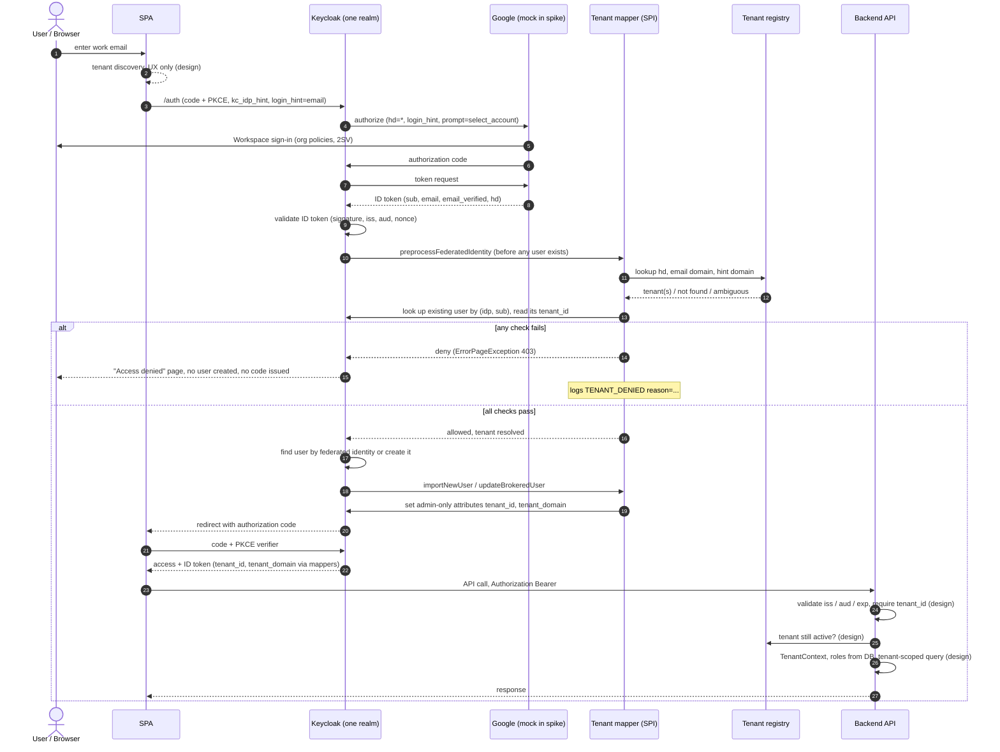

# Test harness for the tenant SPI and the backend

Proves the core enforcement point of
[../docs/multi_tenant_saas_design.md](../docs/multi_tenant_saas_design.md): **resolve the tenant
from a verified `hd` claim, look it up in a domain registry, deny anything that does
not match, and stamp `tenant_id` / `tenant_domain` into the tokens downstream services
receive.**

This harness lets you test the SPI and the backend **without real Google**. It is separate from the real stack
(`../docker-compose.yml`): its own Keycloak container (`spike-keycloak`, port 8380, in-container dev DB), its own
realm (`spike-mt`), its own database (`spike-db`, port 5434) and a mock Google (port 9100). The SPI itself lives in
`../tenant-spi/` and the schema in `../db/init.sql`; both are shared with the real stack. Run it
after any Keycloak upgrade, because the SPI uses an internal Keycloak API.

## What was built

| Piece | Path | Purpose |
|---|---|---|
| Resolver (pure logic) | `../tenant-spi/.../TenantResolver.java` | `hd` + email + hint + existing user → allow/deny with a reason code. No Keycloak types. |
| Registry | `FileTenantRegistry.java`, `tenant-registry.json` | domain → tenant. File-backed, reloads on change, fails closed. Replaceable by an API client via the `TenantRegistry` interface. |
| Keycloak SPI | `TenantResolverMapper.java` | Identity-provider mapper: enforces in `preprocessFederatedIdentity`, stamps attributes in `importNewUser` / `updateBrokeredUser`. |
| Mock IdP | `mock-idp/server.mjs` | Stands in for Google: issues signed ID tokens with whatever `hd` / email claims a scenario needs. |
| Realm setup | `scripts/setup-realm.mjs` | Creates `spike-mt`: client, IdP, mapper, admin-only user attributes, token mappers. |
| E2E suite | `scripts/e2e.mjs` | 20 scenarios through the real authorization-code + PKCE flow. |
| Real-Google spike | `scripts/setup-google-spike.mjs`, `scripts/google-login.mjs`, `scripts/observe-google-spike.mjs`, `google-spike-registry.json` | A realm with the REAL Google IdP (signature validation, issuer check and PKCE on, claim logging on) plus a receiver and an observer for your own sign-ins. Needs your Google OAuth client in `.env.google`. See `../docs/google_spike_runbook.md`. |
| Adversarial suite | `scripts/e2e-attacks.mjs` | Identity-lifecycle and abuse cases (recreated/renamed accounts, aliases, unmanaged accounts, suspension vs refresh tokens). Records OK / GAP / INFO instead of pass/fail. Findings are written up in `../docs/architecture_validation.md`. |
| Backend | `../../google-oidc-poc-backend` | The project's backend: validates the tokens and scopes all data to the token's tenant. Run here with environment overrides (below). See "Backend enforcement". |
| App database | `docker-compose.yml` (`spike-db`), `../db/init.sql` | Postgres with composite keys and forced row-level security, accessed by a non-owner role. |
| Backend e2e | `scripts/e2e-backend.mjs` | 17 checks with real Keycloak tokens against the running backend and database. |

## Run it

```powershell
docker compose up -d --build                           # spike Keycloak on :8380 (admin/admin) + spike database; the image
                                                       # (Keycloak + the tenant plugin) is built by ../Dockerfile, shared with the real stack
node mock-idp/server.mjs                               # mock IdP on :9100 (leave running)
node scripts/setup-realm.mjs                           # create realm spike-mt
node scripts/e2e.mjs                                   # run the scenarios
```

Backend (the real `../../google-oidc-poc-backend`, pointed at the spike with environment variables; port 8195):

```powershell
cd ..\..\google-oidc-poc-backend
mvn test                                               # 39 tests; the 11 database tests need `docker compose up -d` (spike-db) first
$env:SPRING_DOCKER_COMPOSE_ENABLED="false"             # do not let this instance start the real stack's containers
$env:SERVER_PORT="8195"
$env:TENANT_ISSUER="http://localhost:8380/realms/spike-mt"
$env:TENANT_JWK_SET_URI="http://localhost:8380/realms/spike-mt/protocol/openid-connect/certs"
$env:TENANT_AUDIENCE="spike-api"
$env:TENANT_REGISTRY_FILE="../google-oidc-poc-keycloak/test-harness/tenant-registry.json"
$env:TENANT_DB_URL="jdbc:postgresql://localhost:5434/spike"
mvn spring-boot:run
cd ..\google-oidc-poc-keycloak\test-harness; node scripts\e2e-backend.mjs  # 17 checks (add SKIP_EXPIRY=1 to skip the ~65 s expiry check)
```

The backend has no separate "single-tenant" mode any more: it always runs multi-tenant, and the same
configuration keys (`app.tenant.*`) are what point it at the real realm by default.

> **Time zone gotcha.** PgJDBC sends the JVM time zone to Postgres. A machine set to the legacy name
> `Asia/Calcutta` is rejected by current `postgres` images (`FATAL: invalid value for parameter
> "TimeZone"`), which only ship `Asia/Kolkata`. The application pins UTC in `main()` (and the pom does the
> same for tests), so no launcher flag is needed.

Stop: `docker compose down`, end the `node mock-idp/server.mjs` process, and end the backend process on port 8195.

## Results

**Unit tests:** 24/24 (resolver + registry). **End-to-end:** 20/20, re-run from a freshly
recreated realm.

| Scenario | Outcome |
|---|---|
| Known tenants `acme.com`, `globex.com` | Allowed; access **and** ID token carry correct `tenant_id`, `tenant_domain` |
| Returning user | Allowed; no duplicate user |
| `hd=ACME.COM`, email `Upper@ACME.com` | Normalised; resolves to `t-acme`, `tenant_domain=acme.com` |
| No discovery hint | Allowed (hint only ever *denies*, never grants) |
| Unknown domain | 403, no code issued, **no Keycloak user created**, reason `UNKNOWN_DOMAIN` |
| Consumer account with no `hd` | Denied `MISSING_HD` |
| Suspended tenant / SSO disabled | Denied `TENANT_SUSPENDED` / `SSO_DISABLED` |
| `email_verified=false` | Denied `EMAIL_NOT_VERIFIED` |
| Email in another tenant's domain | Denied `EMAIL_DOMAIN_MISMATCH` |
| Discovered tenant ≠ authenticated tenant | Denied `HINT_MISMATCH` |
| Domain claimed by two tenants | Denied `AMBIGUOUS_DOMAIN` |
| Look-alike `acme.com.evil.com` | Denied `UNKNOWN_DOMAIN` (exact match only) |
| Existing user bound to `t-globex` presenting `hd=acme.com` | Denied `USER_TENANT_CONFLICT`; user's binding unchanged |
| User tries to write own `tenant_id` via the account API | **400 `error-user-attribute-read-only`**; value unchanged |
| Registry edited (tenant suspended) | Took effect with no restart; re-activation likewise |

Every denial is asserted three ways: no authorization code, a 403 page, and the SPI's
log line carrying the expected reason code (so a scenario cannot pass because of some
*other* failure).

**Negative control:** with the mapper removed, an unknown-domain login **succeeded** and
created a Keycloak user with **no tenant attribute**. So the harness detects the SPI's
absence, and it also shows that without enforcement a token with no `tenant_id` can be
issued, which is why backends must reject tokens lacking it.

## Authentication flow as built

Steps marked *(design)* are in the architecture but not exercised by this spike
(there is no tenant-discovery service or backend here, and a mock replaces Google).



The checks in order (see `TenantResolver`): `hd` present → email present and verified →
`hd` resolves to exactly one tenant → tenant active → SSO enabled → email domain belongs
to the same tenant → discovery hint (if any) resolves to the same tenant → an already
provisioned user is not bound to a different tenant.

## Backend enforcement (`google-oidc-poc-backend`)

The existing backend was converted to multi-tenant (there is no single-tenant mode left). It requires the tenant
claims and scopes all data to the token's tenant. Code: `com.secufusion.oidcpoc.tenant`.

**Validation layers** (each independent of Keycloak's own checks):

1. signature, issuer and expiry (Spring defaults), with the JWKS fetched from the spike realm;
2. audience must include `spike-api`;
3. `tenant_id`, `tenant_domain` and `sub` must be present — a token without them is rejected;
4. on every request, `TenantContextFilter` re-checks the tenant against the registry: it must exist,
   own the token's `tenant_domain`, be active and have SSO enabled. Only then is a `TenantContext`
   published for the request, and it is always cleared in a `finally`.

**Data layer.** All tenant data goes through `TenantTx`, which opens a transaction and binds the
tenant with `set_config('app.tenant_id', ?, true)`. Repositories filter on `tenant_id` explicitly,
and Postgres row-level security enforces the same boundary independently. Tables use composite keys
and foreign keys that include `tenant_id`. Users are keyed by `(tenant_id, idp_subject)`.

**Results.** Backend unit + database tests: **39/39** (8 token-validator, 8 filter, 5 registry, 7 groups
authorization, 11 against real Postgres). Backend e2e with real tokens: **17/17**.

| Check | Outcome |
|---|---|
| No token / garbage / tampered signature / valid claims signed by an unknown key | 401 |
| Valid token with **no `tenant_id`** | 401, `token is missing tenant_id / tenant_domain / sub` |
| Valid token for **another audience** | 401, `token audience does not include spike-api` |
| Two tenants create documents | Each lists only its own; rows stored under the right `tenant_id` |
| Tenant B requests tenant A's document id | **404**, not 403 (existence not confirmed) |
| `/api/tenants/{tenantId}/documents` | 404 unless the path tenant equals the token's tenant |
| Tenant sent in header, query string or body | Ignored; data stays under the token's tenant |
| User identity | Same `userId` on repeat calls; a different subject or tenant is a different user |
| Tenant suspended in the registry | Its still-valid tokens get 403 `tenant_suspended` immediately; other tenants unaffected; restored on re-activation |
| Expired token | Rejected after expiry |
| `/api/users/{email}/groups` for someone else's email | 403 |
| Existing `/api/me` | Still works |

**Database-level results** (real Postgres, as the app role):

- The app role is neither superuser nor `BYPASSRLS`, and all three tables have RLS enabled **and forced**.
- A query that deliberately omits the tenant predicate still sees only the current tenant's rows.
- A session with no tenant bound, or an empty tenant, sees nothing.
- The tenant binding does not leak to the next use of the same connection.
- Inserting a row for another tenant is blocked by the `WITH CHECK` policy; updating or deleting
  another tenant's row affects 0 rows.
- A comment cannot reference another tenant's document (composite foreign key).
- Data access with no tenant context throws; it never means "all tenants".

**Backend findings**

1. **Owners and superusers bypass RLS.** The application must connect as a role that owns nothing and
   has no `BYPASSRLS`; the test suite asserts this so a misconfiguration fails loudly.
2. **Spring accepts an expired token for 60 s by default** (clock skew). The expiry check therefore
   waits about 65 s. Lower the skew if tokens must die sooner.
3. **A tenant-less token is a real possibility** (see the negative control above), so "no `tenant_id`
   means reject" must be an explicit rule, not an assumption.
4. **Group lookup is per tenant and never trusts the URL.** `UserGroupsController` refuses an email in the
   path that differs from the token's email (403), requires the email's domain to belong to the token's
   tenant, and uses a delegated admin taken from the tenant's registry entry (`groupsDelegatedAdmin`). That
   admin's domain must itself belong to the tenant, so one tenant can never make the service account
   impersonate inside another organization. A tenant with no delegated admin gets 501.
5. **Environment gotcha** — the `Asia/Calcutta` time zone issue described above.

## Findings that change or sharpen the design

1. **Enforce before provisioning, not after.** A post-login authenticator runs after
   Keycloak has already created and linked the user, so a denied login would leave an
   orphan account. The mapper's `preprocessFederatedIdentity` runs *before* user
   creation and sees the already-validated ID token directly, so a denial leaves nothing
   behind (verified: no user created in any denial scenario). The design doc's step 4
   has been updated accordingly. *(That a post-login authenticator would leave an
   orphan is my reading of Keycloak's flow order; I did not build that variant to prove it.)*
2. **The mapper SPI is internal.** Keycloak logs `KC-SERVICES0047 … implementing the
   internal SPI identity-provider-mapper. This SPI is internal and may change without
   notice`. Pin the Keycloak version, keep the SPI thin, and add the spike's e2e suite to
   the upgrade checklist. Check whether newer Keycloak Organizations support removes the need.
3. **Admin-only attributes work as a tamper control.** Declared in the user profile with
   `view`/`edit` = admin, the attributes are rejected on the account API and are not even
   visible to the user.
4. **A bare token with no tenant is possible without enforcement** (negative control),
   so backends must fail closed when `tenant_id` is missing.
5. **User-facing denial is generic.** The user sees "We are sorry… Access denied" (403)
   for every reason; the reason is only in the server log. A tenant-friendly message needs
   a custom message/theme or an authenticator-based page.
6. **Registry failure policy matters.** Implemented: never-loaded → deny all; later reload
   failure → keep last good snapshot (logged). A production registry should bound that
   staleness.

## Not proven by this spike

- **Real Google.** A mock IdP replaced Google. The mapper reads the ID token that Keycloak's
  OIDC base class validates; the Google provider extends that class, but I did not run the
  mapper against the Google provider. Needs one real login (and a personal-Gmail attempt
  with `hd=*`) in a `spike-mt` copy that has the Google IdP.
- **The token-exchange `hd` bypass (CVE-2026-18214).** This mapper protects the normal
  broker login. I did not test whether mappers run on the external token-exchange path.
  Keep Token Exchange V1 disabled (it is off by default).
- **Multi-request first-login flows.** All test personas have complete profiles, so the
  first-broker-login flow never showed a form. The mapper stores its result in the broker
  context and re-derives nothing, and it fails closed if that result is missing, but the
  path where the context is serialized between requests was not exercised.
- **Registry as a network service**, cache TTL behavior, high availability, multi-node
  Keycloak, and performance.
- **Alias / secondary-domain `hd` behavior** and **multi-tenant DWD onboarding** (deferred by agreement).
- **Backend gaps.** Not implemented: tenant roles/permissions (authorities are empty), membership
  tables, group sync and Directory/DWD access, async/background propagation of the tenant context,
  and CORS beyond a single configurable origin list. Not measured: connection-pool behaviour under
  concurrent load (only same-connection reuse was tested), the cost of the per-request registry
  check, or the registry as a network service rather than a file.
- **Real Google with the backend.** The backend e2e uses the same mock IdP as the Keycloak suite.
